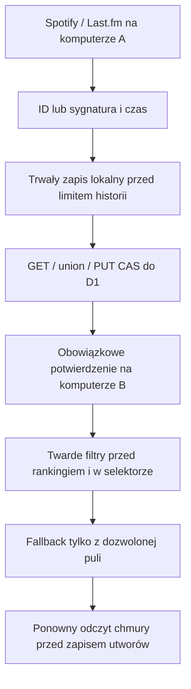

# Wspólny rejestr blokad odtworzeń

Wydanie 1.0.14. Zakres zatwierdzony po audycie playlisty wygenerowanej na
innym komputerze niż eksport historii. Użytkownik zatwierdził scalenie
i wdrożenie PR #57 dnia 16.10.2026.
Baza: main `93844ad` (1.0.13). PR #56 naprawia osobno odczyt historii;
ten zakres jest niezależny, nie zawiera prywatnego backupu ani raportu.

## Przyczyna architektoniczna i reguła

`office_music_history_v1` jest lokalne dla origin/profilu przeglądarki.
Zawartość tej historii nie była synchronizowana między komputerami. Dlatego
poprawny filtr nie mógł wykorzystać odsłuchu znanego wyłącznie drugiemu
komputerowi. Sam backup z innego komputera nie dowodzi dokładnego stanu
wejścia generatora z incydentu; usuwa jednak założenie wspólnej historii.

Potwierdzone odtworzenie Spotify/Last.fm wyklucza utwór przez 14 × 24 h
od czasu zdarzenia, do dokładnego `at + WINDOW` (granica wyłączna).
Nowe odtworzenie odnawia termin. Wygenerowanie/dodanie do playlisty nie
jest odtworzeniem. Przyszłe daty ze źródeł nie są promowane do rejestru.
👍, reset punktów, scoring off i wyczyszczenie lokalnej historii nie
usuwają aktywnych blokad. Bez zmian kwalifikujących pominięć: nadal
osobny `track-cooldown.js` i `/api/track-cooldown` z regułami 1.0.13.

Rejestr odtworzeń przechowuje Spotify Track ID oraz istniejące sygnatury
wykonawca–tytuł/współwykonawca–tytuł. Używa obecnej normalizacji nazw,
Unicode, featuring i wersji, bez nowej heurystyki katalogowej.
Nie przenosi ocen po nazwie i nie blokuje całego wykonawcy.

## Dane, konto i zgodność

`play-cooldown.js`: klucz `office_play_cooldown_v1:<account_id>`, schemat
`{version:1, account, tracks:{ID:at}, signatures:{signature:at}}`.
Timestamp w ms. Jeden najnowszy termin na tożsamość; nie lista odsłuchów.
Brak tokenów, nazw profili obecności, snapshotów playlist, ocen ani
identyfikatora Last.fm w chmurze. Sygnatury zawierają znormalizowane nazwy.

Lokalny zapis przez `OmmLocalState.edit`, retry konfliktu do trzech prób.
Union wybiera max timestamp, usuwa wyłącznie wygasłe wpisy. Do 20000
tożsamości łącznie i 1 MiB JSON; przekroczenie limitu lub quota odmawia
zapisu i blokuje generowanie zamiast wyrzucać aktywne wykluczenia.
Jest to limit nowego rejestru, nie zmiana limitu puli/API/historii.

`capturePlayedHistory()` zapisuje nową partię Spotify/Last.fm przed
`mergeHistoryEntries()` i przycięciem historii do 1500 wpisów. Nieudany
zapis zachowuje partię w pamięci do ponowienia, propaguje błąd źródła
i unieważnia znaczniki TTL obu źródeł, żeby restart wymagał odświeżenia.
Nie dochodzi do pozornego sukcesu synchronizacji z utratą partii.

Przed synchronizacją rejestru następuje także promocja zachowanych
odsłuchów z lokalnej historii. Wyłącznie rekordy z potwierdzonym źródłem:
Spotify `sourceAccount` zgodne z bieżącym zweryfikowanym profilem lub
Last.fm `sourceAccount` zgodne ze wskazaną parą kont. Publiczny Spotify
ID służy tu tylko sprawdzeniu pochodzenia istniejącego rekordu, nigdy
wybraniu partycji chmurowej. Rekordy obce lub bez informacji o właścicielu
pozostają lokalne i nie są automatycznie przypisywane nowemu kontu.
Niepoprawny JSON całej historii przerywa synchronizację. Bezpieczne pola
pojedynczych rekordów są normalizowane przed utworzeniem sygnatur.

Eksport obejmuje rejestr. Import waliduje schemat i scala aktywne wpisy
z obecną kopią wewnątrz blokady importu; stary backup bez nowego klucza
nie może usunąć aktywnych blokad. Nie ma przycisku ich resetowania.

## Endpoint i synchronizacja

`/api/play-cooldown`, istniejące `app_state`, osobny `state_key`.
Brak migracji D1, bindingów lub zmian produkcyjnej konfiguracji.
Właściciel wyłącznie ze zweryfikowanego `/me.account_id`. Body, publiczne
`id` i konfiguracja Last.fm nie ustalają partycji. Ogólne `/api/state`
nie eksportuje ani nie nadpisuje tego osobnego klucza.

GET: `{ok:true,state,base}`, `Cache-Control:no-store`. `state` obejmuje
aktywny union, a `base` jest dokładnym zapisanym JSON do CAS. GET nie
zmienia D1. PUT: `{state,base}`, ścisła whitelist i limity strumienia;
walidacja konta, wersji, tożsamości i dat (maks. 5 minut tolerancji zegara).
Serwer scala również poprzednika, więc pusty/starszy komputer nie usuwa
blokady. CAS w jednym statement; 409 wymusza GET/merge/PUT, maks. 3 próby.
Uszkodzony lub nieobsługiwany stan nie jest nadpisywany.

Klient: `syncPlayCooldown()` sprawdza konto przed i po oczekiwaniu,
401 odnawia token jeden raz, 429 respektuje Retry-After, awaria daje
backoff 2 min. Brak ponowienia niejednoznacznego zapisu sieciowego.
Surowa treść błędu sieci/API nie trafia do komunikatu generatora.
Obowiązkowa synchronizacja czeka na poprzednią synchronizację tła i
następnie wykonuje własne potwierdzenie, także dla nowszej lokalnej partii.
Autosync jest dołączony do obecnego harmonogramu po logowaniu/zmianach
danych i ma memo 10 min wyłącznie przy niezmienionym lokalnym rejestrze.

Generowanie wymusza trzy GET/PUT (bez konfliktów): przed porządkami
Spotify, po pobraniu historii/przed doborem i po utworzeniu pustej
playlisty/przed wysłaniem utworów. Są to żądania nowego endpointu i jego
weryfikacji konta; nie zwiększają budżetu Spotify Search ani pobieranych
stron historii. Błąd pierwszego potwierdzenia zatrzymuje proces przed
porządkami. Błąd ostatniego może pozostawić pustą playlistę Spotify.

## Egzekwowanie

`buildHistoryBlocklists()` dodaje ID/sygnatury rejestru do istniejących
blokad historii. Dzięki temu działają wszystkie obecne filtry kwalifikacji,
stare ścieżki zbierania, świeży selektor, fallback i naprawa discovery.
Fingerprint cache pokrycia zawiera rejestr, a TTL uwzględnia dokładne
granice jego wygaśnięcia. Po końcowym odczycie chmury generator ponownie
sprawdza wybrane utwory; zmiana blokad przerywa zapis z komunikatem.
Minimum 35/osobę, ranking, fairness, xQuAD/MMR i discovery bez zmian.

## Granice i uruchomienie

Wspólne są urządzenia tego samego niezmiennego konta Spotify; profile
obecności nadal nie są czterema osobnymi kontami historii. Rejestr nie
odtworzy odsłuchów, których żaden klient nie zaobserwował lub które
usunięto przed pierwszą promocją. Limity pobierania źródeł pozostają.
Komputer offline nie publikuje zdarzeń do drugiego urządzenia. Zdarzenie
jest widoczne po udanej synchronizacji, a nie w chwili odtworzenia na
wyłączonym komputerze. Spotify i D1 nie tworzą jednej transakcji: nie ma
atomowej ochrony przed zdarzeniem zapisanym po ostatnim potwierdzeniu.

Po zatwierdzonym wydaniu odświeżyć oba komputery na tym samym origin.
Najpierw otworzyć komputer ze znaną historią i potwierdzić synchronizację
rejestru, następnie generować na drugim. Nie kasować historii w celu
inicjalizacji. Stare klienty nie zapisują odtworzeń do nowego rejestru,
więc odświeżenie obu jest potrzebne; nie nadpisują osobnego klucza D1.
Nie wykonywano importu prywatnego backupu do produkcji w tym PR.

Ręcznie: A synchronizuje znany odsłuch; B potwierdza chmurę i odrzuca
utwór mimo cache i 👍/scoring off. Powtórzyć po restarcie B. Awaria endpointu
ma zatrzymać generowanie. W atrapach zegara: tuż przed 14 dniami blokada,
dokładnie po 14 dniach powrót do kandydatów, jeśli inne filtry pozwalają.

Regresje: `play-cooldown.test.mjs`, `play-cooldown-api.test.mjs`,
`play-cooldown-browser.test.mjs`; rzeczywiste dwie oddzielne sesje
przeglądarki, D1 w SQLite w pamięci, zero produkcyjnych API i danych.
Istniejące fixture'y generatora/benchmarku dopisują atrapę nowego endpointu.
Wyniki pełnej walidacji w PR. Rollback: revert kodu, bez usuwania D1 lub
lokalnego rejestru; stary klient przestaje egzekwować wspólne odtworzenia.

## Odłożona weryfikacja użytkownika

Dostęp do komputera z historią: 18.10.2026 (czas polski). Użytkownik
polecił zaparkować dalszą weryfikację do tego czasu. Po powrocie: odświeżyć
OMM 1.0.14 na A, potwierdzić chmurę, następnie generować na B i porównać
wynik. Nie wykonywać teraz importu prywatnego backupu ani generowania
playlist w imieniu użytkownika. PR #56 pozostaje osobnym, niescalonym
audytem/poprawką czytnika. Potwierdzenie platformy wdrożeniowej nie
zastępuje tego rzeczywistego testu dwóch komputerów.
