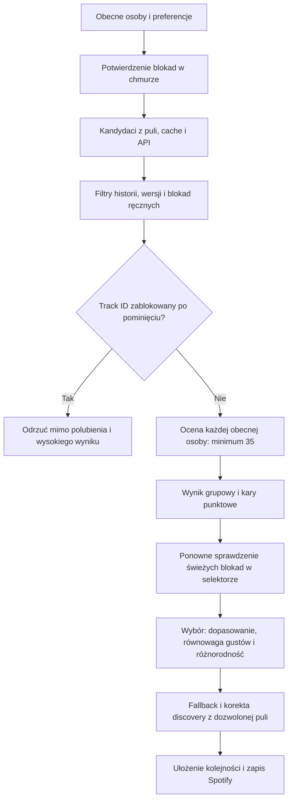

# 1.0.13 — twarda blokada po pominięciu

Decyzja użytkownika 2026-10-16: wdrożyć kolejną wersję po audycie oraz
„blokada 14-dni ma wyższy priorytet niż polubienia i wyłączenia kar”.
To jawna zmiana wcześniejszego kontraktu S2, nie naprawa wag rekomendacji.

## Zachowanie

- Nowe potwierdzone przez monitor prawdopodobne pominięcie early/middle na
  OMM wyklucza **dokładny Spotify Track ID** przez 14 × 24 h od `event.at`.
  Kolejne takie pominięcie odnawia termin. W chwili `at + 14 dni` ta blokada
  wygasa; inne reguły i pozostała kara punktowa nadal mogą wykluczać utwór.
- 👍 resetuje punktację S2, ale nie blokadę. Wyłączenie kar usuwa ich wpływ
  punktowy, ale nie blokadę ani zapis nowych blokad podczas obserwacji.
  Zmiana przełącznika rozpoczyna aktywną obserwację od świeżej kotwicy.
- Late (≥70%), obce playlisty, podcasty, niejednoznaczne przejścia i stare
  diagnostyczne wpisy S1 nie tworzą blokady. Nadal wymagane są oba Track ID
  przejścia w lokalnym snapshotcie OMM i zweryfikowana sesja. Wyłączenie
  samej obserwacji zatrzymuje zbieranie nowych pominięć; nie usuwa blokad.
- Z istniejących S2 importowane są zachowane, niezresetowane zdarzenia z
  ostatnich 14 dni. Zdarzeń wcześniej usuniętych przez reset nie da się
  odzyskać. S1 nie jest źródłem backfillu ani nowych ocen.
- Blokada nie dotyczy całego wykonawcy ani innego Spotify ID tego samego
  nagrania. Historia Last.fm nadal używa swoich sygnatur wykonawca–tytuł.

## Dane i synchronizacja

`track-cooldown.js`: lokalny klucz `office_track_cooldown_v1:<account_id>`,
wersja 1, mapa `tracks: TrackID → ostatni timestamp`. Do 512 aktywnych
utworów, 64 KiB; wygaśnięte wpisy są usuwane przy scalaniu. Union wybiera
max timestamp, pominięcie pola przez starszego klienta nie usuwa blokady.
Brak nazw, wykonawców, tokenów, resetów czy przełącznika wyłączenia blokady.
Limit/quota odmawia nowego zapisu, zachowuje wcześniejsze dane i zatrzymuje
obserwację. Niepoprawny rejestr zatrzymuje wybór zamiast pomijać filtr.

`auto-track-feedback.js` ma hook `preserve`: przed resetem/pruningiem oraz
po dodaniu zdarzenia utrwala blokady w osobnym rejestrze. Nieudane utrwalenie
przerywa reset, więc nie usuwa jedynej kopii daty pominięcia.

`/api/track-cooldown` używa istniejącego `app_state`, osobnego klucza,
zweryfikowanego `/me.account_id` i CAS. Bez migracji SQL, nowych bindingów
ani dostępu do produkcyjnych danych podczas testów. GET scala także
zachowane zdarzenia chmurowego S2. PUT utrwala union poprzednika;
nie usuwa aktywnych blokad przez nadpisanie pustą mapą.

Przed generowaniem `syncTrackCooldown(force:true)` wykonuje GET/merge/PUT.
Po 409 ponawia GET/merge do trzech prób, po 401 jedno odnowienie tokena;
429 respektuje Retry-After, pozostałe awarie mają dwuminutowy backoff.
Nie ponawia niejednoznacznego zapisu po błędzie sieci. Autosync ma osobne
memo 10 min, ale generowanie wymusza potwierdzenie. **Brak potwierdzenia
zatrzymuje generowanie przed utworzeniem playlisty.** Jest to celowy koszt
spójności między urządzeniami. Lokalny blok działa od razu; inne urządzenie
widzi go po udanym przesłaniu do chmury, nie w chwili zapisu offline.

Synchronizacja blokad poprzedza wysłanie resetów S2. Starsi klienci nie
czytają osobnego klucza i go nie nadpisują. Stara wersja aplikacji nie
egzekwuje nowej reguły — wymagane jest odświeżenie strony po wydaniu.
Lokalny eksport/import waliduje i zachowuje rejestr. Nie przebudowujemy
historycznej identyfikacji ani danych LOG1.

## Kolejność wyboru

`generationBlocklists()` zawiera `skipBlockedTracks`.
`eligibleGroupCandidates()` sprawdza je przed punktacją; `selectGroupPlaylist()`
ponownie czyta blokady pominięć oraz historię przed budowaniem
`remaining`/`safeCandidates`. Fallback i naprawa discovery nie mają innej
puli wejściowej. Starszy `collectFromQueries()` również respektuje blokadę.
Cache pokrycia uwzględnia stan rejestru i dokładny termin wygaśnięcia,
także gdy punktacja jest wyłączona. Po utworzeniu pustej playlisty, tuż
przed dodaniem utworów, sprawdzana jest ewentualna nowa lokalna blokada;
w takim przypadku zapis utworów zostaje przerwany z prośbą o ponowienie.

Bez zmian minimum 35/osobę, progów grupowych 44/35, limitu dwóch utworów
na wykonawcę, wag gustów, discovery, pozyskiwania, budżetu Search i RMF.
Lista może być krótsza przy braku dozwolonych zamienników.

## Walidacja i wycofanie

Regresje obejmują zgłoszone daty i przedziały, oba rodzaje kar, dokładne
granice czasu, odnowienie okresu, 👍/off/restart/cache, starego kandydata,
wysoki wynik i fallback/naprawę, aktualność cache pokrycia, realny generator
z atrapą zapisu, CAS dwóch urządzeń, dane S2, izolację kont, quota,
nieobsługiwany schemat oraz brak zapisu Spotify po awarii synchronizacji.
Testy nie wywołują produkcyjnego Spotify ani D1.

Rollback: revert wydania; osobny rejestr i dane S2 pozostają zachowane.
Starszy kod ignoruje blokadę, więc rollback wyłącza jej egzekwowanie.
Nie kasować danych, nie cofać migracji LOG1. Potwierdzenie platformy
wdrożeniowej i pobranie plików nie zastępują rzeczywistego smoke użytkownika.
